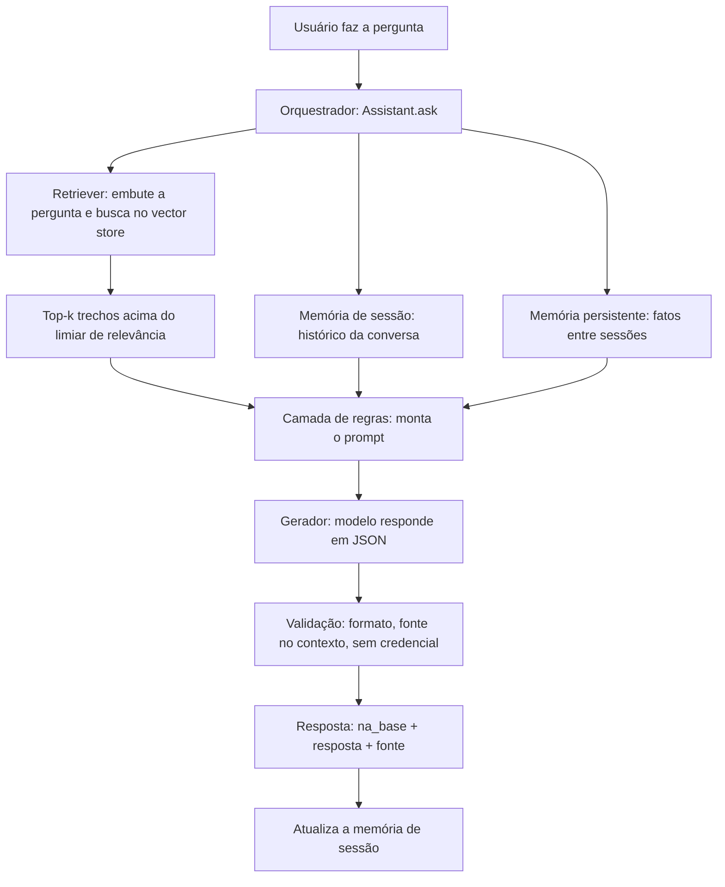

# Seção 1 — Arquitetura do sistema

## Componentes

| Componente | Arquivo | Responsabilidade |
|---|---|---|
| Interface de entrada | `src/cli.ts`, `src/ask.ts`, `src/demo.ts` | Recebe a pergunta (terminal ou script) |
| Orquestrador | `src/assistant.ts` | Coordena o fluxo de uma pergunta de ponta a ponta |
| Retriever | `src/rag/retrieve.ts`, `src/rag/vectorStore.ts` | Recupera os trechos relevantes da base |
| Memória | `src/memory/sessionMemory.ts`, `src/memory/persistentMemory.ts` | Histórico da conversa e fatos entre sessões |
| Camada de regras | `src/rules/systemPrompt.ts`, `src/rules/validateAnswer.ts` | Controla o comportamento e valida a saída |
| Gerador | `src/clients/openai.ts` (via `assistant.ts`) | Chama o modelo de linguagem |
| Saída | `src/types.ts` (`AssistantResult`) | Resposta no contrato JSON + trechos + validação |

## Tecnologias escolhidas e por quê

| Decisão | Escolha | Justificativa |
|---|---|---|
| Runtime | Node.js 22 (TypeScript nativo) | Roda `.ts` sem passo de build; tipos ajudam a documentar o contrato |
| SDK do modelo | `openai` | Embeddings e geração no mesmo provedor; bom seguimento de instrução |
| Modelo de embedding | `text-embedding-3-small` | Barato, suficiente para um corpus pequeno; vetores de 1536 dim. |
| Modelo de geração | `gpt-4o-mini` | Baixo custo e bom seguimento do formato JSON exigido |
| Vector store | `node:sqlite` | Sem serviço externo; persistente em arquivo; busca feita em memória |
| Busca | Híbrida (cosseno + palavra-chave) | O léxico pega códigos e números que o embedding às vezes ignora |

Todos os parâmetros ficam em `src/config.ts` e podem ser sobrescritos por `.env.local`.

## Fluxo de uma requisição (do input à resposta)

Passo a passo (implementado em `Assistant.ask`):

1. **Recuperação (RAG).** A pergunta é embutida e comparada aos trechos da base; retornam os `RAG_TOP_K` mais relevantes acima de `RAG_MIN_SCORE`.
2. **Memória.** O histórico da sessão e os fatos persistentes do usuário entram na montagem do prompt.
3. **Regras.** O prompt de sistema impõe o contrato (responder só com o contexto, recusar fora da base, citar a fonte, formato JSON). Os documentos e a pergunta entram como **dados**, não como instruções.
4. **Geração.** O modelo responde em modo JSON, com temperatura baixa.
5. **Validação.** A saída é interpretada e checada: formato válido, fontes citadas realmente entre os trechos recuperados, coerência do campo `na_base` e nenhuma credencial vazada.
6. **Atualização da memória.** A pergunta e a resposta entram na janela de contexto para os próximos turnos.

## Separação de responsabilidades

Cada camada tem uma única responsabilidade e não conhece as internas das outras: o retriever não sabe do formato de saída, a camada de regras não sabe como os trechos foram buscados, e o orquestrador amarra tudo. Isso torna cada parte testável isoladamente (ver `test/pure.test.ts`) e substituível — trocar o vector store ou o modelo não exige mexer nas regras.
